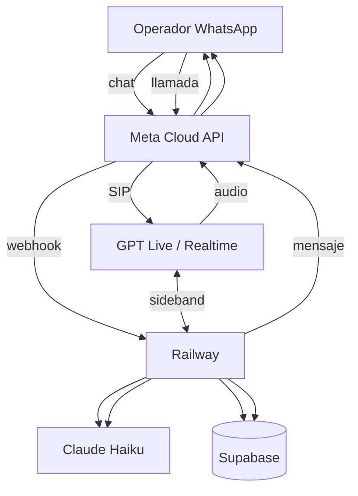

# Propuesta 3 — stack ligero (WhatsApp + Railway + Supabase)

Misma solución de negocio que [propuesta 1](../propuesta-1/README.md) y [propuesta 2](../propuesta-2/README.md): **WhatsApp** (chat y llamada), tres flujos en **YAML**, LLM solo **clasifica**, consola de casos, **sin transferencia en vivo**.

Cambia el **cómo se despliega**: menos piezas de infra que AWS+LiveKit+Deepgram+Cartesia, inspirado en stacks tipo tutorial (Railway, Supabase, Haiku, GPT Live), pero con **entrada por WhatsApp**, no por número PSTN aparte.

Comparación: [diferencias-propuestas.md](../diferencias-propuestas.md). Requisitos comunes: [docs/](../docs/README.md).

## Stack en una línea

```text
WhatsApp (Meta) → Railway (lógica + webhooks) → Supabase (casos, sesión, audios)
                      ↓ chat                              ↑
                 Claude Haiku (clasificar)          motor YAML
                      ↓ voz (llamada WhatsApp)
                 GPT Live / OpenAI Realtime (audio) ← sideband → Railway + YAML
```

| Pieza | Rol |
| --- | --- |
| **WhatsApp** | Único canal: mensajes, fotos (después), **llamadas de WhatsApp**. Meta Cloud API + webhook HTTPS. |
| **Railway** | Servicios HTTP: webhook de Meta, API de consola, **orquestador del YAML** (fuente de verdad del paso). Cola interna o worker en el mismo proyecto. |
| **Supabase** | Postgres (casos, historial enmascarado, versiones de flujo), Storage (fotos, audios fijos de pasos), Auth para la consola de mesa. |
| **Claude Haiku** | En **chat** (y en voz vía herramientas): convierte texto del operador en `sí` / `no` / `no_entendí` / `persona`. **No redacta** el procedimiento. |
| **GPT Live (OpenAI Realtime)** | En **llamada**: escucha y habla. Las instrucciones limitan al agente a leer el script del paso actual; cada turno llama a Railway para clasificar (Haiku) y obtener el siguiente id + URL del audio o texto a decir. |

No entran: Zernio (teléfono PSTN), LiveKit Cloud, Deepgram, Cartesia, ECS, RDS propio en AWS (Supabase los sustituye en piloto).

## Qué es esta arquitectura

Un solo producto, **dos caminos** que comparten Postgres y el motor YAML en Railway.

**Chat.** Meta envía el webhook a Railway. Railway responde 200, encola el procesamiento, lee/escribe sesión en Supabase, manda el texto a **Haiku**, aplica el YAML, responde con la API de WhatsApp. Las fotos van a Supabase Storage.

**Voz (llamada WhatsApp).** Meta entrega la llamada por **SIP** (WhatsApp Calling). Objetivo del piloto: terminar ese SIP en **OpenAI Realtime** (documentado: llamadas entrantes SIP + webhook `realtime.call.incoming`). OpenAI lleva el audio; por **sideband WebSocket** vuestro servicio en Railway:

1. Recibe transcripción del turno (o texto derivado del evento).
2. Llama a **Haiku** para la etiqueta.
3. Consulta el **YAML** y Supabase (paso, intentos).
4. Devuelve al Realtime qué decir (texto corto) o dispara reproducción de un clip ya subido a Storage.

Así el árbol sigue siendo **determinista**; GPT Live es **interfaz de voz**, no el autor del flujo.



## Flujo de una llamada (paso a paso)

1. El operador **llama** al número de WhatsApp Business de soporte.
2. **Meta** enruta la llamada por SIP hacia el destino configurado (trunk / partner acordado con Meta).
3. **OpenAI Realtime** acepta la llamada (`realtime.call.incoming` → `accept`) con instrucciones fijas: “solo guías según lo que te indique el backend; no improvises procedimientos”.
4. Railway mantiene en Supabase la sesión (teléfono, flujo, paso, intentos), igual que en chat.
5. Cada vez que el operador habla, Realtime notifica; Railway manda el texto a **Haiku** → etiqueta → **motor YAML** → siguiente paso.
6. **Respuesta:** texto breve para que Realtime lo hable, o indicación de reproducir audio de Storage (pasos grabados una vez, como S3/MinIO en otras propuestas).
7. Si escala: caso en Postgres, **mensaje WhatsApp** con número de caso; la mesa devuelve la llamada. Sin transferencia en vivo.

Si Meta **no** permite apuntar el SIP de WhatsApp Calling directamente a OpenAI, plan B en el mismo documento de PoC: un **puente mínimo** (LiveKit OSS o SIP proxy) solo transporta audio; la inteligencia sigue siendo Realtime + Railway. Eso sube un poco la complejidad pero sigue siendo más simple que Deepgram + Cartesia + agente custom.

## Flujo de chat (paso a paso)

1. Webhook Meta → Railway (verificación y mensajes).
2. Sesión en Supabase (Redis opcional no hace falta al inicio; filas con TTL o `updated_at`).
3. Haiku clasifica el texto del operador.
4. Motor YAML elige el siguiente id; Railway envía plantilla/botones/texto por Graph API.
5. Mismo árbol que voz; si el operador pasa de chat a llamada, la sesión se reutiliza por número.

## Dónde va cada pieza

| Pieza | Dónde | Notas |
| --- | --- | --- |
| Webhook + motor YAML | **Railway** | Un repo, 1–2 servicios (API + worker opcional). |
| Casos, sesión, consola | **Supabase Postgres** | RLS para roles mesa / Censo. |
| Fotos y audios de pasos | **Supabase Storage** | URLs firmadas; retención acotada. |
| Login consola | **Supabase Auth** | Sustituye Cognito en piloto. |
| Clasificación | **Anthropic API (Haiku)** | Solo etiquetas; prompts cortos. |
| Voz entrante | **OpenAI Realtime / GPT Live** | Minutos facturados a OpenAI. |
| Canal | **Meta (WhatsApp)** | Igual que propuestas 1 y 2. |

## Consola de mesa

Igual criterio que propuesta 1: consola web ligera (Next o Vite) hosteada en Railway o Vercel, leyendo Supabase. Cola, tomar caso, enlace `wa.me` para devolver la llamada, cierre con causa.

## Costos mensuales (orden de magnitud)

Mismos supuestos que [propuesta-1/costos.md](../propuesta-1/costos.md): 22 días, 2 incidencias/día, 50 % chat / 50 % voz, 6 min/llamada. Sin desarrollo ni impuestos. Precios **orientativos** (Railway/Supabase/OpenAI cambian seguido).

### 15 operadores

| Concepto | US$ / mes (aprox.) |
| --- | ---: |
| Railway (API + worker) | 20–40 |
| Supabase (Pro o equivalente) | 25–35 |
| Claude Haiku (chat + clasificación voz) | 5–15 |
| OpenAI Realtime (~2.000 min/mes) | 80–150 |
| WhatsApp (mensajes) | ≈ 3 |
| **Total** | **≈ 130–240** |

En piloto chico puede quedar **por debajo de propuesta 1 (~300)** si el minuto Realtime no se dispara; hay que **medir** en PoC.

### 1.400 operadores

| Concepto | US$ / mes (aprox.) |
| --- | ---: |
| Railway / Supabase (escalados) | 150–400 |
| Haiku | 50–120 |
| Realtime (~560k min/mes si 50 % voz) | **dominante** (miles USD) |
| WhatsApp mensajes | ≈ 295 |
| **Total** | **variable; revisar tarifa Realtime antes de escalar** |

A gran escala, propuesta 1 o 2 pueden ser más predecibles que Realtime por minuto; la 3 gana en **time-to-market** y simplicidad operativa en el piloto, no necesariamente en costo masivo.

## Tiempo de implementación (una persona)

| Fase | Días | Qué queda |
| --- | ---: | --- |
| Meta + Railway + Supabase + YAML “sin internet” | 8–12 | Chat funcionando |
| Haiku + consola mínima | 10–15 | Casos y mesa |
| PoC WhatsApp Calling → Realtime (+ plan B SIP) | 10–20 | **Riesgo Meta/OpenAI** |
| Tres flujos chat + voz + endurecimiento | 15–25 | Paridad con propuesta 1 |
| **Total al piloto** | **~55–70 días** | Similar o algo menos que P1 si el SIP encaja a la primera |

El camino crítico sigue siendo **habilitar llamadas en WhatsApp** (Meta), en paralelo desde el día 1.

## Ventajas

- Menos servicios que mantener que propuesta 1 (sin LiveKit Cloud, Deepgram, Cartesia, Terraform grande).
- Mismo canal **WhatsApp** que el negocio pidió (a diferencia del tutorial con Zernio/PSTN).
- Chat y datos en un stack que un dev conoce rápido (Railway + Supabase).
- Voz en un solo proveedor de audio (OpenAI) si el SIP funciona.

## Riesgos y mitigaciones

| Riesgo | Mitigación |
| --- | --- |
| Meta no enruta SIP de WhatsApp a OpenAI | PoC de 1 semana; plan B puente SIP mínimo |
| Realtime “improvisa” fuera del YAML | Sideband obligatorio; Haiku + YAML en Railway; instrucciones estrictas + tools |
| Costo Realtime al crecer | Tablero de minutos; replantear P1/P2 |
| Datos en Supabase + OpenAI + Anthropic | Ley 1581: enmascarado, retención, DPA; no sustituye P2 on-premise |
| Dos LLM providers | Se puede unificar clasificación en OpenAI mini en chat; Haiku se mantuvo por alineación con el video/referencia |

## PoC recomendado (antes de comprometer la propuesta)

1. Número WhatsApp de prueba con **calling** habilitado.
2. Una llamada de punta a punta: operador → Meta → Realtime → sideband Railway → un solo paso YAML.
3. Medir latencia percibida y costo por minuto.
4. Confirmar con documentación Meta / soporte si el destino SIP puede ser el trunk de OpenAI.
5. Si falla (2), probar puente LiveKit OSS **solo media**, lógica igual en Railway.

## Qué no entra

Igual que el resto de propuestas: foto del cargador, nota de voz, reenvío automático de credenciales, inventario, guía offline en tableta, LLM voz-a-voz libre sin YAML.

## Referencias externas

- [OpenAI — Voice / SIP](https://developers.openai.com/api/docs/guides/voice-sip) (llamadas entrantes Realtime).
- [Meta — WhatsApp Cloud API](https://developers.facebook.com/docs/whatsapp/cloud-api/) (mensajes y calling según producto habilitado).
