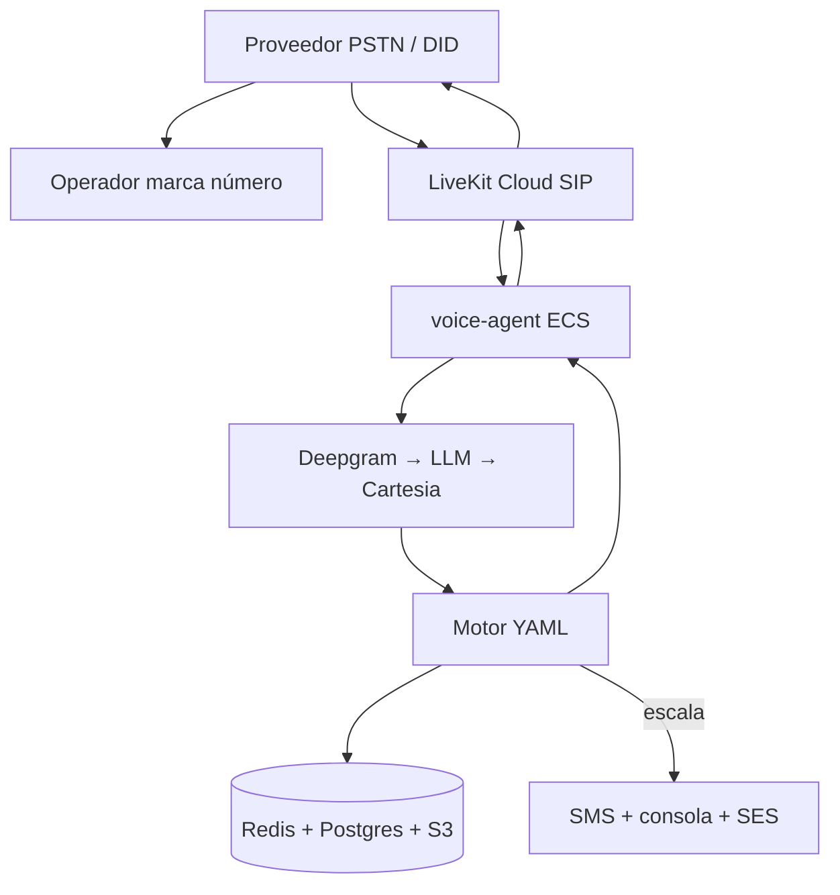

# Propuesta 4 — misma nube que la 1, entrada por teléfono (PSTN)

Misma **infraestructura de voz e IA** que [propuesta 1](../propuesta-1/README.md): **AWS** (ECS Fargate, RDS, Redis, S3), **LiveKit Cloud**, **Deepgram**, **Cartesia**, LLM de clasificación, motor **YAML**, consola de casos, **sin transferencia en vivo**.

Cambia el **canal de entrada**: el operador **marca un número telefónico normal** (fijo o móvil, voz PSTN), no WhatsApp. Corresponde a la **línea con voicebot** que el PDF deja como fase 2, pero con el mismo stack técnico que la propuesta 1.

Comparación: [diferencias-propuestas.md](../diferencias-propuestas.md). Comportamiento del agente: [docs/analisis-agente-voz.md](../docs/analisis-agente-voz.md).

Imagen (diagrama + piezas + costos): [arquitectura.png](arquitectura.png). Solo diagrama: [arquitectura-diagrama.png](arquitectura-diagrama.png). Regenerar: `python3 propuesta-4/generate_arquitectura.py`.

## Qué se mantiene de la propuesta 1

| Pieza | Igual que P1 |
| --- | --- |
| `voice-agent` (LiveKit Agents en ECS) | Escucha, clasifica, habla, DTMF, crea caso |
| LiveKit Cloud | Salas, SIP, ruido, despacho al agente |
| Deepgram + LLM + Cartesia | Pipeline de voz; pasos fijos en S3 |
| RDS, Redis, S3, Cognito, SES, consola | Casos, sesión, audios, mesa |

## Qué cambia

| Antes (P1) | Propuesta 4 |
| --- | --- |
| Meta WhatsApp (chat + llamada) | **Proveedor PSTN** (número DID + minutos entrantes) |
| `gateway` + `worker` + webhook Meta | `gateway` solo **API de consola** y webhooks del proveedor telefónico (estado de llamada, opcional) |
| Escalar: mensaje WhatsApp con número de caso | **SMS** al celular del operador y/o **correo** a la mesa; la mesa **devuelve la llamada** al mismo número |
| Fotos por WhatsApp | **Fuera del piloto** (o fase posterior con otro canal) |

En el piloto se asume **100 % de incidencias por llamada telefónica** (sin chat).

## Flujo de una llamada

1. El operador **marca** el número de soporte (local, 01xxx, o móvil según contrato con el proveedor).
2. El **proveedor PSTN** (Twilio, Telnyx, Zernio u otro) recibe la llamada y la envía por **SIP** a **LiveKit Cloud** (trunk entrante configurado en LiveKit).
3. LiveKit abre sala, cancela ruido y asigna un **`voice-agent`** libre (ECS).
4. **Deepgram → LLM → Cartesia** (+ audios de paso en S3), mismo árbol YAML (logueo, sin internet, tableta dañada).
5. **Redis** guarda paso e intentos; **Postgres** el caso si escala.
6. Al escalar: mensaje de voz con número de caso; **SMS** con el mismo número (si el proveedor lo permite) y alerta en consola + **SES**.
7. La mesa **llama de vuelta** al operador con el teléfono del caso (no `wa.me`).

## Elección del proveedor PSTN

Cualquier carrier que entregue **SIP hacia LiveKit** sirve. Ejemplos documentados en el ecosistema:

| Proveedor | Rol |
| --- | --- |
| **Twilio** | Número + Elastic SIP Trunk → LiveKit |
| **Telnyx** | Similar; buena tarifa LATAM en muchos despliegues |
| **Zernio** | Número + `forwardTo` SIP o integración con agentes |

LiveKit documenta **inbound trunks**; la propuesta 4 no ata a una marca: en costos se usa un rango **≈ 0,012–0,02 US$/min** entrante + renta del número.

## Consola de mesa

Igual que P1 salvo:

- Botón **“Llamar al operador”** (`tel:+57…`) en lugar de WhatsApp.
- Sin bandeja de fotos WhatsApp en el piloto.

## Tiempos (una persona)

| | Propuesta 1 | Propuesta 4 |
| --- | ---: | ---: |
| Hasta piloto | ~70 días | **~55–65 días** |

Se omiten chat WhatsApp, verificación de número Meta y llamadas WhatsApp; se suma **número PSTN + trunk SIP + prueba de calidad de línea** (~3–8 días).

Detalle de fases en [tiempos.md](tiempos.md).

## Costos

Tablas en [arquitectura.png](arquitectura.png) y [costos.md](costos.md). Supuesto: todas las incidencias son **llamada de 6 min** (≈ 4.000 min/mes con 15 operadores; ≈ 370.000 min/mes con 1.400).

## Cuándo elegir propuesta 4

- Operadores **sin datos** o que **no usan WhatsApp** en el puesto.
- Cliente quiere **misma robustez que P1** en voz pero **sin depender de Meta**.
- Aceptan **perder chat y fotos** en el piloto (o abrirlos después con P1 en paralelo).

## Qué no entra

- WhatsApp (chat o llamada).
- Fotos del cargador por mensajería.
- Transferencia en vivo a la mesa.
