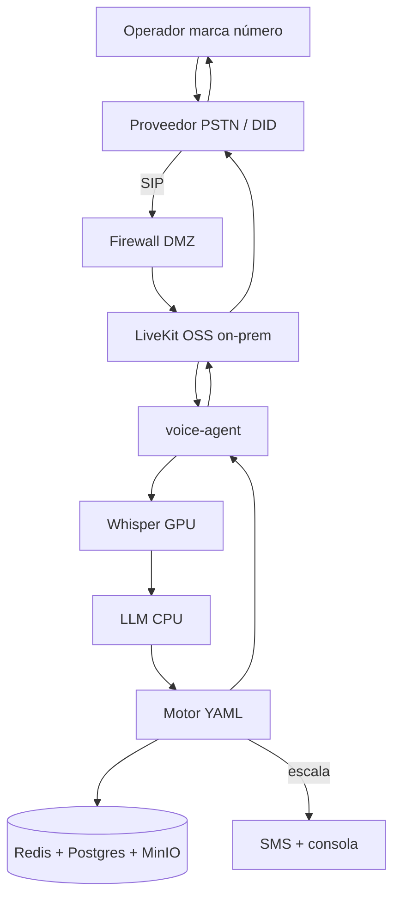

# Propuesta 5 — PSTN + voz e IA on-premise

Mezcla de [propuesta 4](../propuesta-4/README.md) y [propuesta 2](../propuesta-2/README.md): el operador **marca un número telefónico normal** (como P4) y **LiveKit, STT, TTS, LLM y datos corren en el datacenter** (como P2).

Misma solución de negocio que el resto: tres flujos en **YAML**, LLM solo **clasifica**, consola de casos, **sin transferencia en vivo**. En el piloto **no hay WhatsApp** (ni chat ni fotos).

Comparación: [diferencias-propuestas.md](../diferencias-propuestas.md). Comportamiento del agente: [docs/analisis-agente-voz.md](../docs/analisis-agente-voz.md).

Imagen (diagrama + piezas + costos): [arquitectura.png](arquitectura.png). Solo el diagrama: [arquitectura-diagrama.png](arquitectura-diagrama.png). Regenerar: `python3 propuesta-5/generate_arquitectura.py`.

## Documentos de esta propuesta

| Documento | Qué es |
| --- | --- |
| [costos.md](costos.md) | Costo mensual estimado (15 y 1.400 operadores). |
| [tiempos.md](tiempos.md) | Calendario para una persona (~75–85 días hábiles). |

## Stack en una línea

```text
Operador marca número → Proveedor PSTN (DID + SIP)
    → LiveKit OSS (on-prem) → voice-agent
    → Faster-Whisper (GPU) → LLM chico (CPU) → Motor YAML
    → MinIO / Piper → audio de vuelta por SIP
    → si escala: SMS + consola + devolución PSTN
```

## Qué toma de cada propuesta

| De P4 (PSTN) | De P2 (on-premise) |
| --- | --- |
| Entrada por **teléfono normal** (DID) | LiveKit **open source** en datacenter |
| Escalamiento por **SMS / voz** + devolución PSTN | Faster-Whisper (GPU) + Piper (CPU) |
| Sin chat ni fotos en el piloto | LLM chico local; Redis, Postgres, MinIO en sitio |
| Proveedor SIP (Twilio, Telnyx, Zernio…) hacia el trunk | Sin Deepgram, Cartesia ni LiveKit Cloud |

## Qué es esta arquitectura

Dos recintos, no dos productos.

**Nube (solo telefonía).** Un proveedor PSTN entrega el número DID y reenvía la llamada por **SIP** hacia el datacenter. No interpreta, no guarda el caso, no habla el procedimiento.

**On-premise (todo lo demás).** LiveKit propio termina el SIP. El `voice-agent` orquesta. Faster-Whisper pasa voz a texto. El motor YAML decide el paso. Piper habla. Redis, Postgres y MinIO quedan en la red del cliente. La consola de mesa también.

Sigue siendo un toma y dame: texto → sí/no/persona → id de paso → audio. El LLM no redacta.

## Flujo de una llamada

```text
Operador marca el número de soporte
    → Proveedor PSTN (nube): DID + minutos; SIP hacia el datacenter
    → Reverse proxy / firewall (DMZ): solo SIP/HTTPS necesarios
    → LiveKit (on-prem): sala, mezcla, ruido
    → voice-agent: toma el audio de la sala
    → Faster-Whisper (GPU): audio → texto
    → LLM chico (CPU): sí / no / no_entendí / persona
    → Motor YAML + Redis: siguiente id de paso
    → MinIO o Piper: audio del paso (o número de caso)
    → LiveKit → proveedor PSTN → el operador oye el siguiente paso
```

Paso a paso:

1. El operador **marca** el número de soporte (fijo, 01xxx o móvil).
2. El **proveedor PSTN** recibe la llamada y la envía por SIP al datacenter (trunk entrante).
3. **LiveKit OSS** termina el SIP, abre sala, cancela ruido y avisa a un `voice-agent` libre.
4. **Faster-Whisper** convierte a texto; el **LLM** etiqueta; el **YAML** elige el siguiente paso.
5. Audio de respuesta: clip en **MinIO** o síntesis **Piper** (frase suelta: número de caso).
6. Si escala: caso en **Postgres**, número de caso por **voz** y **SMS** (si el proveedor lo permite); la mesa **llama de vuelta** por PSTN. Sin transferencia en vivo.



## Dónde va cada pieza

| Pieza | Dónde | Qué es | Por qué así |
| --- | --- | --- | --- |
| Celular del operador | Campo | Marca el número de soporte. | Sin datos ni WhatsApp en el piloto. |
| Proveedor PSTN | **Nube** | DID + minutos entrantes + SIP hacia el datacenter. | Entrada telefónica normal; no se hospeda el carrier. |
| Reverse proxy / firewall | **On-premise (DMZ)** | SIP (y HTTPS de consola/API) hacia adentro. | Solo se publica lo que el trunk necesita. |
| LiveKit (open source) | **On-premise** | Termina SIP, salas, ruido, despacho al agente. | Sustituye LiveKit Cloud y el cobro por minuto SIP cloud. |
| `voice-agent` | **On-premise** | Orquesta STT, LLM, YAML, TTS, DTMF, caso. | Misma pieza que P2; sin Fargate. |
| Motor de flujos (YAML) | **On-premise** | Logueo, sin internet, tableta dañada. | Determinismo; LLM no redacta. |
| Faster-Whisper (STT) | **On-premise, GPU** | Voz a texto en streaming. | Sustituye Deepgram. |
| LLM chico local | **On-premise, CPU** | Sí / no / no entendí / persona. | Sustituye Haiku/GPT-mini en nube. |
| Piper (TTS) | **On-premise, CPU** | Voz del agente; pasos fijos en MinIO. | Sustituye Cartesia. |
| Redis + Postgres + MinIO | **On-premise** | Sesión, casos, audios. | Datos del caso no salen. |
| Consola de casos | **On-premise** | Bandeja de la mesa; botón “Llamar” (`tel:+57…`). | Sin Cognito/CloudFront; sin bandeja WhatsApp. |
| SMS / correo | Proveedor PSTN o correo local | Número de caso al escalar. | Sustituye mensaje WhatsApp de P1/P2. |

## Qué se necesita en el datacenter

Igual que [propuesta 2](../propuesta-2/README.md#qué-se-necesita-en-el-datacenter), con SIP desde el carrier (no desde Meta):

| Escala | Cómputo | Red |
| --- | --- | --- |
| 15 operadores (~1 llamada a la vez) | 1 servidor GPU + 1 servidor CPU | IP pública o NAT; puertos SIP hacia el trunk del proveedor |
| 1.400 operadores (pico ~40–50) | 6–8 GPU T4 + 3 servidores CPU | Lo mismo, más ancho de banda de audio |

Si el reconocimiento falla dos veces: teclado DTMF (`1` sí, `2` no, `0` persona), igual que en las demás.

## Costos mensuales (resumen)

Detalle en [costos.md](costos.md). Supuestos: 22 días, 2 incidencias/día, **100 % llamada** de 6 min (como P4).

| Escala | P5 (esta) | P2 (WA on-prem) | P4 (PSTN nube) |
| ---: | ---: | ---: | ---: |
| 15 operadores | ≈ **240** | ≈ 220 | ≈ 310 |
| 1.400 operadores | ≈ **2.030** | ≈ 1.800 | ≈ 4.800 |

En 15 el ahorro frente a P4 es chico; en 1.400 el minuto de voz **deja de tener tarifa Deepgram + LiveKit Cloud**. Queda el costo del **PSTN** (que P2 no tiene) y el hardware.

## Tiempo de implementación

~**75–85 días** hábiles con una persona. Más que P4 (sin Meta, pero con GPU/LiveKit propio) y un poco menos que P2 (sin chat WhatsApp ni verificación Meta). Detalle: [tiempos.md](tiempos.md).

## Cuándo elegir propuesta 5

- Operadores **sin WhatsApp / sin datos** en el puesto (como P4).
- Cliente exige que **transcripciones y casos no salgan** a Deepgram, Cartesia ni LiveKit Cloud (como P2).
- Volumen alto donde el SaaS de voz por minuto se vuelve caro (como P2 vs P1/P4).
- Aceptan **operar GPU y SIP** en el datacenter y **perder chat/fotos** en el piloto.

## Frente a P2 y P4

| | P2 | P4 | **P5 (esta)** |
| --- | --- | --- | --- |
| Canal | WhatsApp | PSTN | **PSTN** |
| Hosting voz/datos | On-premise | AWS + SaaS | **On-premise** |
| Chat / fotos | Sí | No | **No** |
| STT / TTS | Whisper + Piper | Deepgram + Cartesia | **Whisper + Piper** |
| 15 op. / mes | ≈ 220 | ≈ 310 | ≈ **240** |
| 1.400 op. / mes | ≈ 1.800 | ≈ 4.800 | ≈ **2.030** |
| Días al piloto | ~85–90 | ~60–65 | ~**75–85** |

## Qué no entra

WhatsApp (chat o llamada), fotos por mensajería, transferencia en vivo, reenvío automático de credenciales, inventario, guía offline, LLM voz-a-voz libre sin YAML.
