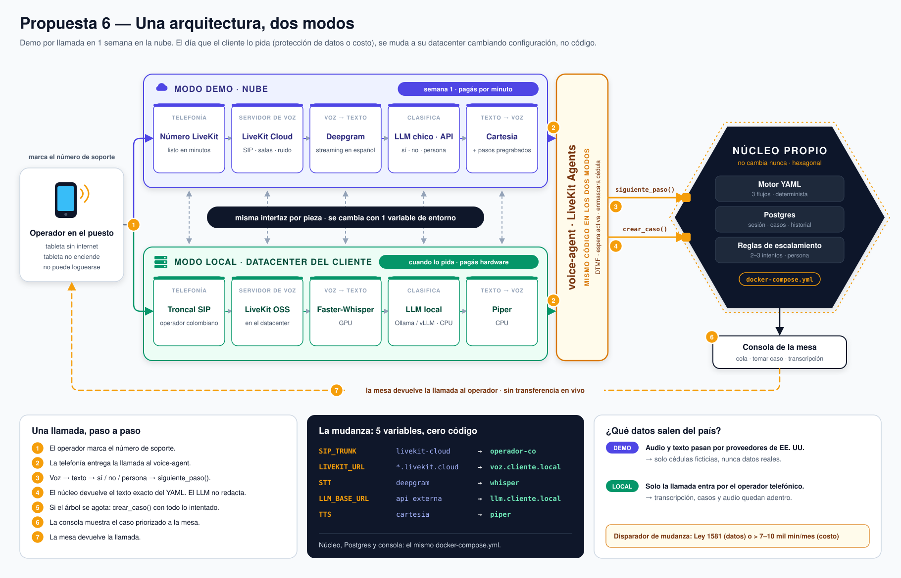

# Propuesta 6 — una arquitectura, dos modos (demo en nube → local)

El operador **marca un número de teléfono** (como P4 y P5). El agente de voz se construye **una sola vez** con **LiveKit Agents** y corre en dos modos:

- **Modo demo / nube**: LiveKit Cloud, Deepgram, Claude Haiku 5.5 y Cartesia. Se puede mostrar en **una semana**.
- **Modo local**: LiveKit OSS, Faster-Whisper, LLM local y Piper en el datacenter del cliente. Es el destino de P5.

Pasar de un modo al otro es **cambiar configuración, no código**. El cliente puede pedir la mudanza **en cualquier momento**, por **protección de datos** (Ley 1581) o por **costo**, y la arquitectura tiene que soportar ese pedido sin reescribir nada.

Misma solución de negocio que el resto: tres flujos en **YAML**, el LLM solo **clasifica**, consola de casos y **sin transferencia en vivo**.

Comparación: [diferencias-propuestas.md](../diferencias-propuestas.md). Comportamiento del agente: [docs/analisis-agente-voz.md](../docs/analisis-agente-voz.md).

Imagen con costos: [arquitectura.png](arquitectura.png) ([SVG](arquitectura.svg)). Solo el diagrama: [arquitectura-diagrama.png](arquitectura-diagrama.png). Regenerar: `python3 propuesta-6/generate_arquitectura.py` (el PNG necesita `rsvg-convert`: `brew install librsvg`).

## Documentos de esta propuesta

| Documento | Qué es |
| --- | --- |
| [costos.md](costos.md) | Semana de demo, modo nube y modo local (15 y 1.400 operadores). |
| [tiempos.md](tiempos.md) | Demo en 5 días, camino al piloto y mudanza a local. |
| [plan-de-accion.md](plan-de-accion.md) | **Plan de acción y tareas día por día** (documento de trabajo). |

## Por qué existe esta propuesta

Las cinco anteriores obligan a elegir **hoy** entre nube (P1, P3, P4) y local (P2, P5). Pero:

1. El entregable inmediato es una **demo por llamada en una semana**, y ninguna sale en ese plazo (55 a 90 días).
2. El cliente **no tiene WhatsApp verificado**, y Meta tarda de 5 a 15 días en verificarlo. Por eso la entrada es por teléfono.
3. La mudanza a local **puede llegar en cualquier momento**. Elegir una plataforma cerrada (Vapi, Retell, ElevenLabs Agents) obliga a rehacer la capa de voz el día que el cliente la pida: ninguna se puede instalar en el datacenter del cliente.

P6 resuelve las tres cosas: **arranca como P4** (nube, rápido) y **termina como P5** (local), con el mismo código.

## Las reglas que hacen posible la mudanza

Se respetan desde el **día 1 de la demo**. Si alguna se rompe, la mudanza vuelve a costar semanas.

| # | Regla | Qué evita |
| --- | --- | --- |
| 1 | El **núcleo** (motor YAML, sesión, casos, reglas de escalamiento) **no conoce a LiveKit**. Expone `next_step()` y `create_case()`; el `voice-agent` es un adaptador. | Que cambiar el proveedor de voz toque la lógica de negocio. |
| 2 | Transcripción, LLM y síntesis de voz se eligen **por variable de entorno**. Se prefieren proveedores con API compatible con OpenAI: así entra un servidor local cambiando la dirección. | Reescribir el agente para usar Whisper, Piper o un LLM local. |
| 3 | **Postgres plano.** Nada de Auth, Storage ni RLS de un proveedor amarrados al código. | Mudar servicios propietarios además de la base. |
| 4 | **Todo en `docker-compose.yml`** desde el primer día: núcleo, base, consola y agente. | "En mi máquina anda": el mismo archivo corre en la notebook, en una VM y en el datacenter. |
| 5 | **Telefonía separada del servidor de voz.** El número que marca el operador apunta por SIP a donde le digas. | Cambiar el número que conocen los operadores el día de la mudanza. |
| 6 | **Cédulas ficticias** mientras se use el modo nube con proveedores externos. | Exponer datos personales (Ley 1581) en la demo. |
| 7 | **Set de regresión de 30–50 llamadas grabadas** (con ruido de puesto) que se corre contra cada modo. | Mudarse a ciegas: el set dice si Whisper entiende igual que Deepgram. |

## La mudanza: qué cambia

| Pieza | Modo demo / nube | Modo local | Variable |
| --- | --- | --- | --- |
| Telefonía | Número de LiveKit Cloud | Troncal SIP de un operador colombiano | `SIP_TRUNK` |
| Servidor de voz | LiveKit Cloud | LiveKit OSS en el datacenter | `LIVEKIT_URL` |
| Voz → texto | Deepgram | Faster-Whisper (GPU) | `STT` |
| Clasificación | Claude Haiku 5.5 (SDK de Anthropic) | LLM local (Ollama o vLLM, CPU) | `CLASSIFIER` + `LLM_BASE_URL` |
| Texto → voz | Cartesia (+ pasos pregrabados) | Piper (+ pasos pregrabados) | `TTS` |
| Núcleo, Postgres, consola | Docker en una VM | **El mismo** Docker en el datacenter | — |

Cuidado: LiveKit no tiene conectores oficiales de Whisper ni de Piper. Se instalan como **servidores de inferencia aparte** y se conectan por el conector compatible con OpenAI ([foro de LiveKit](https://community.livekit.io/t/installing-whisper-piper-selfhosted-help/1672)). Ese trabajo está contado en [tiempos.md](tiempos.md).

## Flujo de una llamada (igual en los dos modos)

1. El operador **marca** el número de soporte.
2. La telefonía entrega la llamada por **SIP** al servidor LiveKit, que despacha un `voice-agent`.
3. El agente pasa la voz a texto y el LLM etiqueta: `yes` / `no` / `unclear` / `human`. Si el reconocimiento falla dos veces: teclado (`1` sí, `2` no, `0` persona).
4. El agente llama a `next_step(session, label)`. El **núcleo** devuelve el id y el texto exacto del paso del YAML. **El LLM no redacta el procedimiento.**
5. Si el árbol se agota o el operador pide una persona: `create_case()` con todo lo intentado, y el agente dicta el número de caso.
6. La **consola** muestra el caso priorizado a la mesa.
7. La mesa **devuelve la llamada**. Sin transferencia en vivo.

Comportamientos del agente que no cambian entre modos (detalle en [analisis-agente-voz.md](../docs/analisis-agente-voz.md)): espera activa al reiniciar la tableta (pregunta cada 20–30 s), una acción por turno, interrupción permitida, cédula siempre por teclado.

## Alcance de la demo (semana 1)

| Entra | No entra (va al piloto) |
| --- | --- |
| Llamada al número de soporte | Número colombiano (el trámite arranca ya, en paralelo) |
| Tres flujos YAML completos por voz | Audios pregrabados por paso (en la demo, síntesis directa) |
| Cédula por teclado, escalamiento con número de caso | SMS con el número de caso |
| Consola mínima: cola, detalle, tomar caso | Login por persona, alertas por correo, indicadores |
| Todo en `docker-compose.yml` sobre una VM | CI/CD, ambientes `dev` y `piloto` |
| Video de respaldo grabado | Set de regresión completo (en la demo, 10 llamadas) |

**Número para la demo:** número de LiveKit Cloud. Si al día 1 no hay número de Colombia, se usa uno de Estados Unidos (llamada internacional, aceptable en una demo) y, como respaldo, la llamada desde el navegador. Para un número colombiano propio, Twilio pide identificación y dirección dentro de la zona del número ([Twilio — Colombia](https://www.twilio.com/en-us/guidelines/co/regulatory)). Ese trámite tarda días y se inicia ya.

## Cuándo mudarse a local

| Disparador | Señal | Urgencia |
| --- | --- | --- |
| **Protección de datos** | El cliente exige que la voz, las transcripciones y los casos no salgan del país o de su red. | **Inmediata y total.** El cuello de botella es el **hardware** (GPU), no el código: conviene cotizarlo antes de que lo pidan. |
| **Costo** | Más de ~7.000–10.000 minutos por mes ([referencia de terceros](https://meetrix.io/blogs/ai-phone-agent-cost/)). Con 1.400 operadores son ~370.000 minutos. | Planificada: se corre el set de regresión, se migra un grupo de operadores y luego el resto. |

## Frente a P4 y P5

| | P4 | P5 | **P6 (esta)** |
| --- | --- | --- | --- |
| Canal | Teléfono | Teléfono | **Teléfono** |
| Hosting | AWS + servicios de voz | Local | **Nube primero, local cuando se pida** |
| Infraestructura en nube | ECS, RDS, Terraform | — | **VM + Docker Compose** (mismo archivo que en local) |
| Demo | ~día 28 | Después del hardware | **Día 5** |
| Al piloto (1 persona) | ~60–65 días | ~75–85 días | **~45–50 días** (modo nube) |
| Mudanza a local | Rehacer infra y voz | Ya es local | **~15–20 días, sin tocar el núcleo** |
| 15 operadores / mes | ≈ 310 | ≈ 240 | ≈ **180** nube · ≈ 240 local |
| 1.400 operadores / mes | ≈ 4.800 (*) | ≈ 2.030 | ≈ **5.400** nube · ≈ **2.030** local |

(*) Ver la nota de [costos.md](costos.md): sumando las líneas de P4 a 1.400 operadores da unos 6.900, no 4.800.

## Riesgos

| Riesgo | Mitigación |
| --- | --- |
| Latencia o ruido de puesto arruinan la experiencia de voz | Probar con ruido el **día 2**, no el 5. Teclado como respaldo siempre activo. |
| Whisper entiende peor que Deepgram el acento colombiano | El set de regresión se corre en los dos modos **antes** de mudar. Ajustar el modelo (large-v3) y el vocabulario. |
| Alguien amarra el núcleo a un proveedor ("solo por esta vez") | Regla 1 en revisión de código: el núcleo no importa nada de LiveKit ni de proveedores. |
| La mudanza por datos llega sin hardware | Cotizar GPU (o colocation en Colombia) apenas termine la demo. |
| Una sola persona: cualquier bloqueo mueve el hito | La demo tiene video de respaldo; el número colombiano se tramita en paralelo. |

## Qué no entra

WhatsApp (chat o llamada), fotos por mensajería, transferencia en vivo, reenvío automático de credenciales, inventario, guía offline en la tableta, LLM voz-a-voz libre sin YAML.

## Fuentes

- [LiveKit — Self-hosting](https://docs.livekit.io/transport/self-hosting/)
- [LiveKit community — Whisper y Piper locales](https://community.livekit.io/t/installing-whisper-piper-selfhosted-help/1672)
- [Twilio — Requisitos de números en Colombia](https://www.twilio.com/en-us/guidelines/co/regulatory)
- [Vapi — FAQ (sin instalación local)](https://docs.vapi.ai/faq) · [Dograh — ¿Se puede instalar Vapi o Retell localmente?](https://www.dograh.com/feeds/blog/self-host-vapi)
- [Meetrix — Costo local vs Vapi vs Retell](https://meetrix.io/blogs/ai-phone-agent-cost/)
